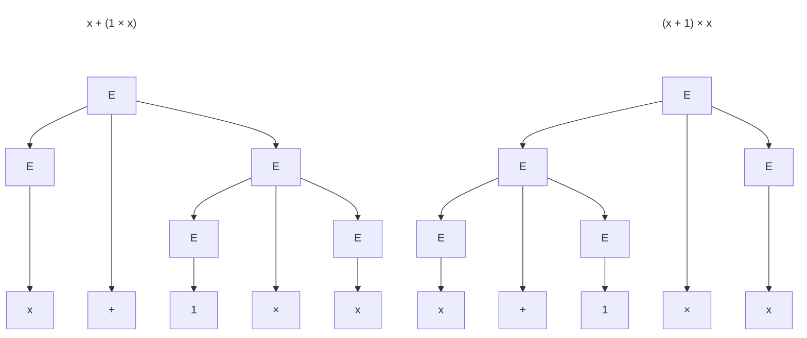

---
tags:
  - computer-science/program-synthesis
draft: true
---
### Intro

The goal of **program synthesis** is to find a program that matches some specification. The process of finding such a program is called **synthesis**, and the program that finds such a program is called a **synthesizer**. The open question in program synthesis is how to synthesize programs efficiently, and flexibly. In this document we look into building the fundamentals of program synthesis from the ground up. 

### Syntax and semantics

A programming language has two sides:

- Its **syntax** is the form of programs: which strings count as valid programs, and how these strings are structured.
- Its **semantics** is the meaning of programs: what they compute when they are run.

The two are defined separately. The expressions $x + x$ and $2 \times x$ differ in syntax, but under the usual meaning of $+$ and $\times$ they have the same semantics: both double $x$. Conversely, the same syntax can be given different semantics: `7 / 2` evaluates to $3$ in C and to $3.5$ in Python 3.

We focus on syntax first, and semantics second.

### Formal languages

- An **alphabet** $\Sigma$ is a finite set of symbols.
- A **string** over $\Sigma$ is a finite sequence of symbols from $\Sigma$. The set of all such strings is denoted $\Sigma^*$.
- A **formal language** is any subset $L \subseteq \Sigma^*$.

Viewed syntactically, a programming language is a formal language: the set of strings the compiler accepts. This set is usually infinite, so we need a finite object that describes it.

### Context-free grammars

A **context-free grammar** (**CFG**) is a tuple $G=(N, \Sigma, R, S)$ where:

- $N$ is a finite set of **nonterminals**, which are names for syntactic categories.
- $\Sigma$ is a finite set of **terminals**, disjoint from $N$.
- $R \subseteq N \times (N \cup \Sigma)^*$ is a finite set of **production rules**, written $A \to \beta$.
- $S \in N$ is the **start symbol**.

Let $\alpha, \gamma \in (N \cup \Sigma)^*$ and let $A \to \beta$ be a rule in $R$. Then $\alpha A \gamma$ **yields** $\alpha \beta \gamma$ in one **derivation step**, denoted as $\alpha A \gamma \Rightarrow \alpha \beta \gamma$. Note that applying the rule $A \to \beta$ does not depend on the context $\alpha$ and $\gamma$ around it. This is why the grammar is called context-free. The right-hand side $\beta$ may contain any mix of terminals and nonterminals, including $A$ itself, and it may be the empty string $\varepsilon$.

We say $\alpha$ **derives** $\beta$, written $\alpha \Rightarrow^* \beta$, if $\beta$ can be reached from $\alpha$ in zero or more steps. Formally, $\alpha$ derives $\beta$ if there exist some strings $\alpha_0, \alpha_1, \dots, \alpha_n$ with $n \geq 0$ such that:
$$
\alpha = \alpha_0 \Rightarrow \alpha_1 \Rightarrow \dots \Rightarrow \alpha_n = \beta
$$

Such a sequence of derivation steps is called a **derivation**. A derivation is called a **leftmost derivation** if every step replaces the leftmost nonterminal. The definition of a rightmost derivation follows similarly.

The **language** of a grammar $G$ is the set of all strings of terminals that can be derived from the start symbol: $L(G) = \{ w \in \Sigma^* \mid S \Rightarrow^* w \}$. A language $L \subseteq \Sigma^*$ is a **context-free language** if $L = L(G)$ for some context-free grammar $G$.

> [!note]
> Other classes of grammars and languages exist, such as **regular languages** (described by regular expressions), **context-sensitive languages**, and **Turing-recognizable languages**. This document does not cover these languages, since program synthesis is mostly built on top of context-free grammars.

### Parse Trees

A **parse tree** of $G$ is a finite rooted tree, with ordered children and a label on every node, such that:

- The root is labelled $S$.
- Every inner node is labelled with a nonterminal $A \in N$. If its children are labelled $X_1, \dots, X_k$ from left to right, with $k \geq 1$, then $A \to X_1 \dots X_k$ is a rule in $R$. A rule $A \to \varepsilon$ gives a single child labelled $\varepsilon$.
- Every leaf is labelled with a terminal in $\Sigma$, or with $\varepsilon$.

The **yield** of a parse tree is the string obtained by concatenating its leaf labels from left to right. A string $w \in \Sigma^*$ is in $L(G)$ exactly when some parse tree has yield $w$. A parse tree records which rules were applied where, but not in which order. Several derivations can therefore share one tree, while each tree corresponds to exactly one leftmost derivation.

A string $w$ is **ambiguous** in $G$ if there are two different parse trees with yield $w$, or equivalently two different leftmost derivations of $w$. A grammar is **ambiguous** if at least one string in $L(G)$ is ambiguous in it.

For example, take the grammar $E \to E + E \mid E \times E \mid x \mid 1$ with start symbol $E$. It is ambiguous, because the string $x + 1 \times x$ has two different leftmost derivations:

| Read as $x + (1 \times x)$ | Read as $(x + 1) \times x$ |
| --- | --- |
| $E$ | $E$ |
| $\Rightarrow E + E$ | $\Rightarrow E \times E$ |
| $\Rightarrow x + E$ | $\Rightarrow E + E \times E$ |
| $\Rightarrow x + E \times E$ | $\Rightarrow x + E \times E$ |
| $\Rightarrow x + 1 \times E$ | $\Rightarrow x + 1 \times E$ |
| $\Rightarrow x + 1 \times x$ | $\Rightarrow x + 1 \times x$ |

The corresponding parse trees have the same yield, but a different shape:

%%
Maintainer note for the parse tree diagram below.

Preferences:
- A tree is most readable if edges exit the bottom of each node and enter the top of the next.
- Every leaf has its own column on one bottom row, so the leaves read left to right as the string.
- The two trees sit side by side, in the same order as the columns of the table above.
- One exception is fine: Quartz (Mermaid) shows the outer edges of a root node leaving from its sides.

Obsidian and Quartz render this with different layout engines (Pele and Mermaid), so check changes in both.

What we do to make it work:
- A flowchart without subgraphs. In Obsidian, block-beta drew edges into the sides of nodes.
- Longer arrows (--->, ---->) push all leaves down to the bottom row.
- The odd order of node declarations and edges is deliberate. It was found by testing both engines, and reordering lines may shuffle the leaves.
- The titles are borderless nodes linked to the roots with invisible edges (~~~).
%%

These two readings compute different things. So the string is not the right object to attach meaning to. The tree is.

